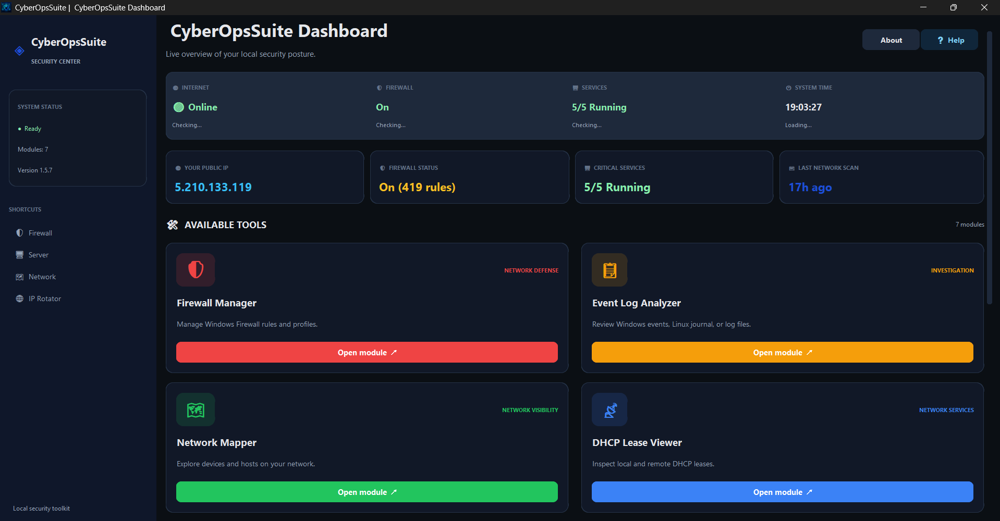
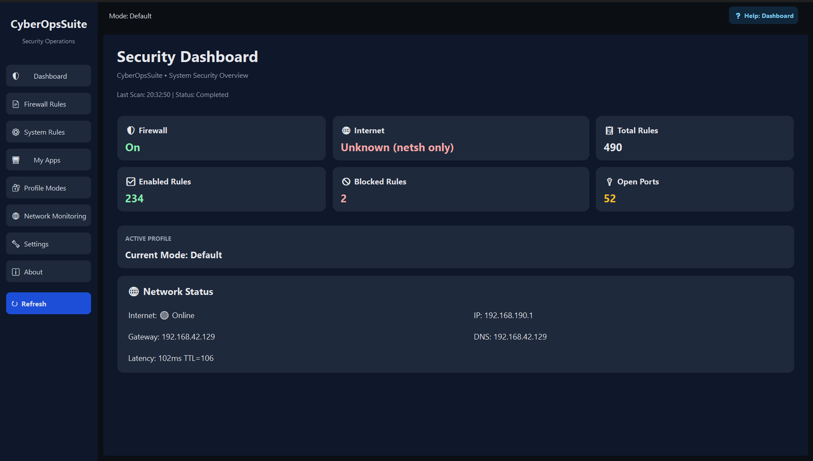
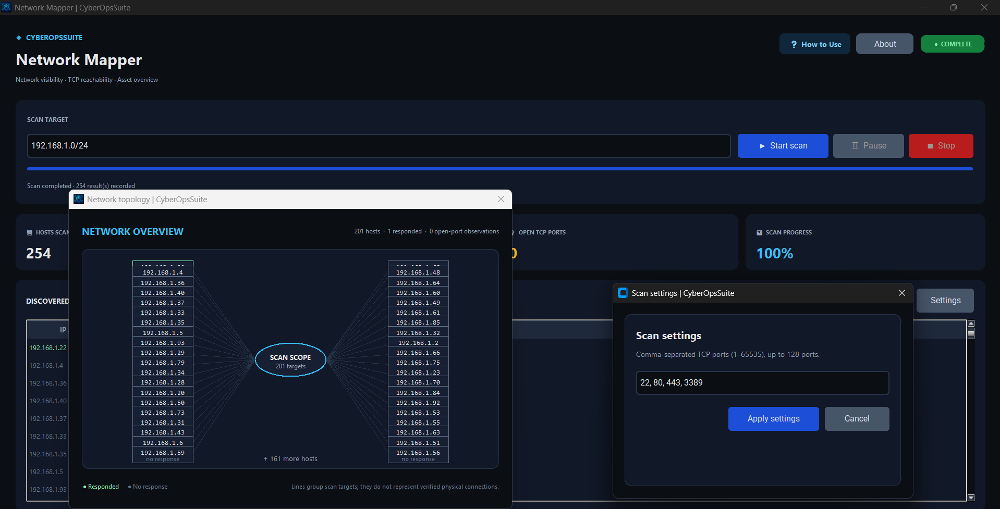
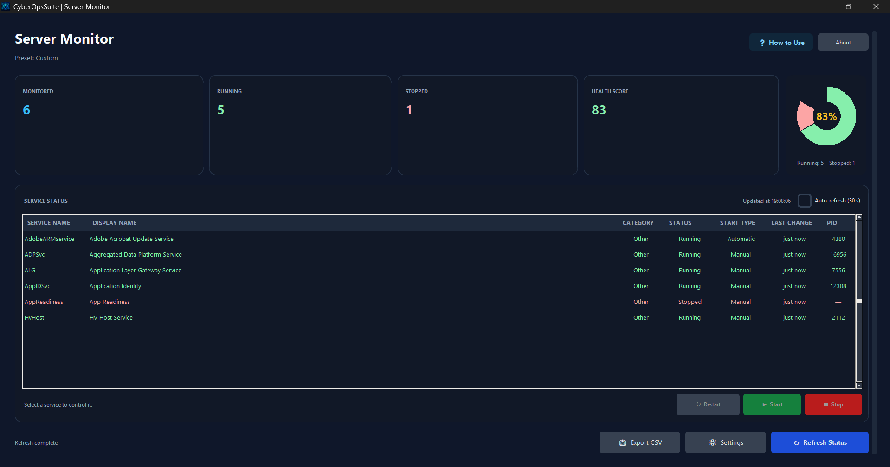
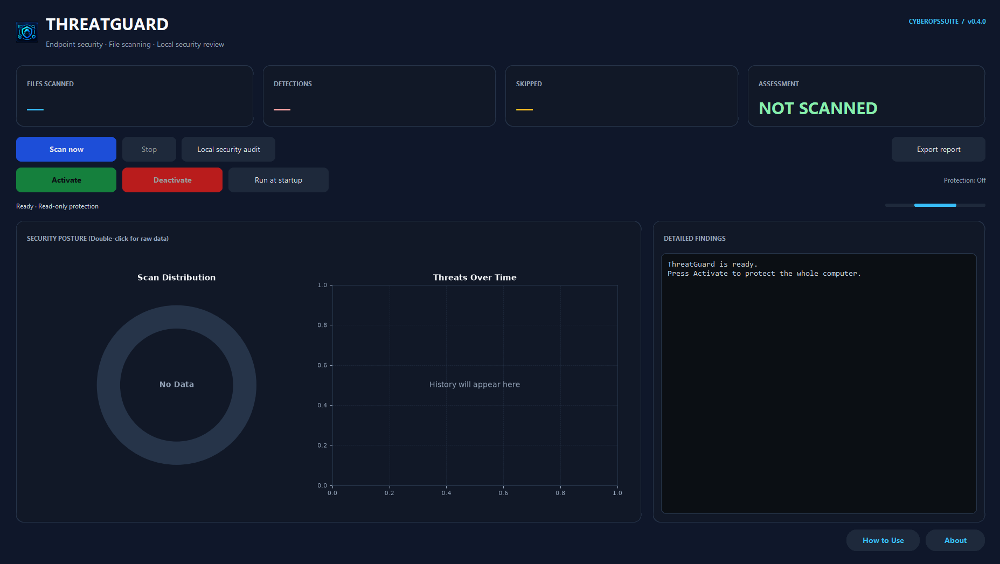
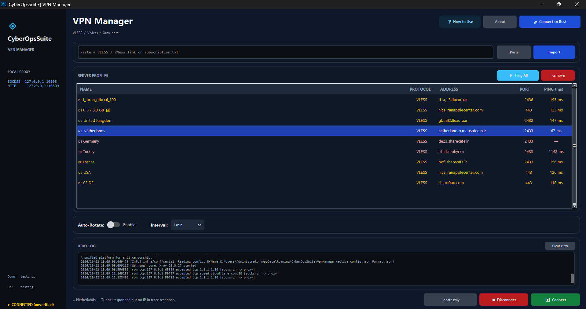
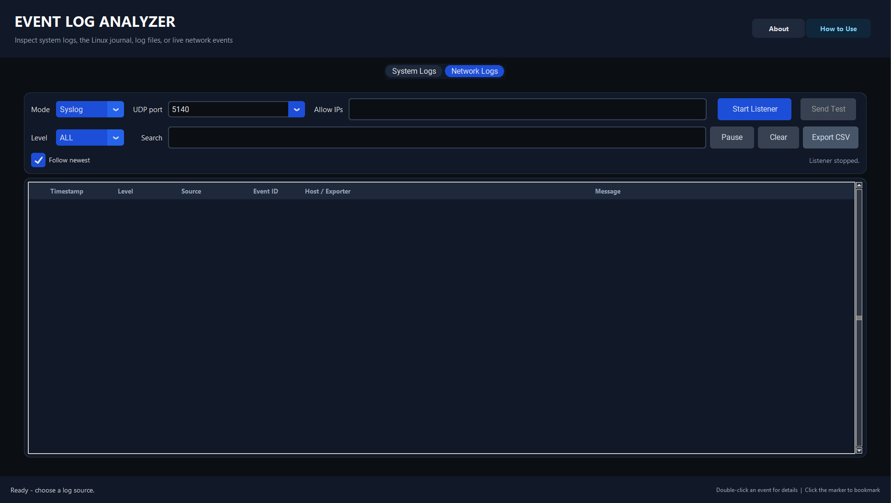
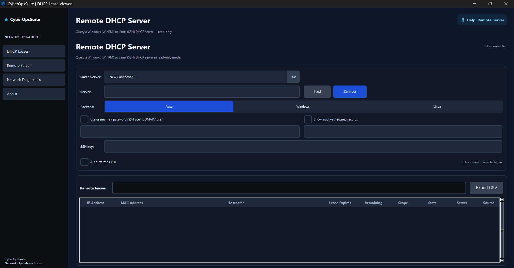
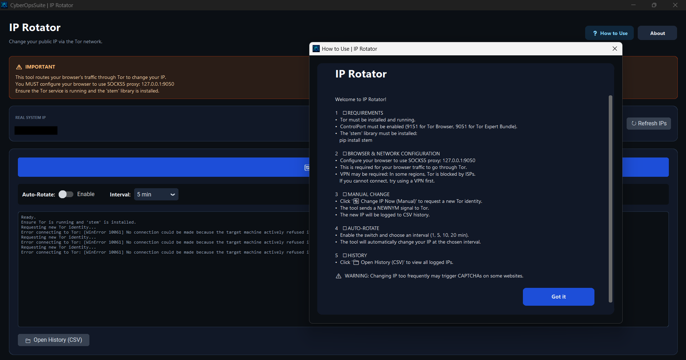

# CyberOpsSuite

**یه جعبه‌ابزار امنیتی ماژولار و چندسکویی برای مدیران ویندوز و لینوکس.**

CyberOpsSuite هشت ابزار امنیتی مستقل رو زیر یه داشبورد یکپارچه جمع می‌کنه.
هر ماژول توی پروسه‌ی خودش اجرا می‌شه، از یه تم تیره‌ی مشترک استفاده می‌کنه،
و می‌تونه به‌صورت مستقل هم اجرا بشه. هر ماژول یه راهنمای **How to Use**
داخلی داره (در ماژول‌های چندصفحه‌ای، راهنما مخصوص هر صفحه‌ست).

> **📌 یه نکته درباره‌ی نحوه‌ی ساخت این پروژه**
>
> CyberOpsSuite با **وایب کدینگ** ساخته شده — یه فرآیند همکاری
> تکراری بین یه انسان و یه دستیار هوش مصنوعی. کد از طریق گفتگوی
> طبیعی نوشته، بازبینی و اصلاح شده، نه با برنامه‌ریزی قدم‌به‌قدم
> سنتی.
>
> ما به شفافیت اعتقاد داریم. پروژه کار می‌کنه، ولی محصول همکاری
> انسان-هوش مصنوعیه، نه تلاش یه انسان تنها. مشارکت، گزارش باگ، و
> بازخورد سازنده خوش‌آمده.

---

## 📥 دانلود

می‌تونید آخرین نسخه‌ی مستقل ویندوز رو از اینجا دانلود کنید:
👉 **[دانلود CyberOpsSuite (ویندوز)](https://github.com/LorinBuilds/CyberOpsSuite/releases/latest)**
*(برای اجرای فایل exe نیازی به نصب پایتون نیست)*

---

## 📸 اسکرین‌شات‌ها

یه نمای کلی از ماژول‌های موجود در CyberOpsSuite:

| ماژول | پیش‌نمایش |
| :--- | :--- |
| **داشبورد** |  |
| **مدیریت فایروال** |  |
| **نقشه شبکه** |  |
| **مانیتور سرور** |  |
| **ThreatGuard** |  |
| **مدیریت VPN** |  |
| **آنالیزور لاگ** |  |
| **نمایشگر DHCP** |  |
| **چرخش IP** |  |

---

## ماژول‌ها

| ماژول | کاربرد | سیستم‌عامل |
|-------|--------|------------|
| Firewall Manager | مدیریت قوانین فایروال (netsh / ufw / nft / iptables) | ویندوز + لینوکس |
| Event Log Analyzer | خواندن لاگ‌های ویندوز، ژورنال لینوکس، فایل JSON Lines، یا شنود زنده‌ی Syslog و NetFlow | ویندوز + لینوکس |
| Network Mapper | اسکن هم‌زمان ICMP + TCP برای کشف هاست و پورت | ویندوز + لینوکس |
| DHCP Lease Viewer | مشاهده لیزهای DHCP محلی و کوئری سرورهای راه دور | ویندوز + لینوکس |
| Server Monitor | مانیتور و کنترل سرویس‌های محلی با Health Score و نمودار | ویندوز + لینوکس |
| **ThreatGuard** ⭐ | دفاع read-only روی اندپوینت: اسکن فایل، Guard پیوسته، بازبینی سیستم، audit، hardening، rootkit، baseline | ویندوز + لینوکس |
| VPN Manager | مدیریت پروفایل‌های VLESS/VMess با Xray-core، REALITY، Smart Auto-Switch و سرعت زنده | ویندوز + لینوکس |
| IP Rotator | تغییر IP عمومی با شبکه Tor | ویندوز + لینوکس |

---

## ویژگی‌های کلیدی

### در کل مجموعه
- **داشبورد یکپارچه تیره** با وضعیت زنده سیستم، آمار سراسری و آخرین فعالیت‌ها
- **راهنمای How to Use داخلی** در تمام ماژول‌ها (در ماژول‌های چندصفحه‌ای، مخصوص هر صفحه)
- **عملیات Thread-based** — رابط کاربری هرگز هنگ نمی‌کنه
- **پیش‌فرض Read-only** — هیچ ماژولی بدون اقدام صریح، سیستم راه دور رو تغییر نمی‌ده
- **چندسکویی** — ویندوز ۱۰/۱۱/Server 2019+ و لینوکس (مبتنی بر systemd)
- **لاگ‌گیری در AppData** — هر ماژول یه فایل لاگ برای عیب‌یابی می‌نویسه
- **فرمت‌های خروجی متعدد** — JSON، CSV، HTML
- **نوتیفیکیشن دسکتاپ** برای رویدادهای حیاتی
- **GUI مستقل، CLI و (اختیاری) API محلی HTTP** برای بیشتر ماژول‌ها

### Event Log Analyzer
- **تب System Logs** — لاگ‌های ویندوز (Application/System/Security)، ژورنال لینوکس (System/User/Kernel)، فایل JSON Lines
- **تب Network Logs** — شنود زنده‌ی UDP برای **Syslog** (RFC 3164 / RFC 5424) و **NetFlow v5**
- **شمارنده‌های زنده** — packets، events، rate، rejected، malformed، unsupported، dropped
- **بوکمارک** — پین کردن رویدادها برای مرور بعدی
- **Pause / Resume** — فریز جدول در حالی که capture ادامه داره
- **Follow newest** — اسکرول خودکار به جدیدترین رویداد
- **Send Test** — تست listener با یه بسته‌ی نمونه
- **Auto refresh** — بارگذاری مجدد لاگ‌های سیستم هر ۵ تا ۶۰ ثانیه
- **محافظت از CSV injection** — سلول‌های شبیه فرمول خنثی می‌شن
- **دسته‌بندی flow مشکوک** — SYN خالی به پورت‌های حساس (RDP/SSH/SMB…) به‌عنوان ERROR علامت می‌خوره

### ThreatGuard
- **اسکن فایل** — دیتابیس هش SHA-256، signatureهای داخلی، YARA (اختیاری)، ClamAV (اختیاری)
- **حالت Guard پیوسته** — بازبینی دوره‌ای همه‌ی درایوها با کش مبتنی بر تغییرات
- **watcher USB** — درایوهای removable لحظه‌ی وصل شدن اسکن می‌شن
- **بازبینی جامع سیستم** — event logs، autostart، processes، اتصالات شبکه
- **audit امنیتی محلی** — مجوز کلیدهای SSH، اطلاعات سیستم‌عامل، یادآوری‌های دستی
- **شاخص‌های rootkit** — `ld.so.preload`، مسیرهای مخفی، درایورهای مشکوک، ناهنجاری `svchost.exe`
- **سخت‌سازی سرور** — تنظیمات SSH، فایل‌های world-writable، Windows Firewall، SMBv1
- **baseline یکپارچگی** — درخت فایل SHA-256، مقایسه در صورت نیاز
- **تحلیل لاگ مشکوک** — ورودهای ناموفق، SQLi، XSS، path traversal، reverse shell، ماینر کریپتو
- **Read-only به‌صورت طراحی‌شده** — هیچ چیزی حذف، قرنطینه یا تغییر نمی‌شه
- **GUI با نمودار** — نمودار دایره‌ای توزیع اسکن، نمودار خطی تهدیدها در طول زمان
- **سیستم‌تری** — کمینه کردن به tray در حین اجرای Protection
- **اجرای خودکار با ویندوز** — ورودی اختیاری per-user
- **نوتیفیکیشن** — tray balloon، PowerShell toast، plyer
- **REST API محلی + CLI** — اسکریپت‌نویسی بدون GUI

### VPN Manager
- **VLESS + REALITY + رمزنگاری Post-Quantum** — پروتکل‌های مدرن Xray
- **VMess** با پشتیبانی از flow اختیاری
- **Networkها** — TCP، WebSocket، gRPC، HTTPUpgrade، xhttp / splithttp
- **TLS + certificate pinning** — کار با سرورهای خودامضا بدون `allowInsecure`
- **ایمپورت Subscription URL** — ایمپورت همه‌ی سرورها با یه کلیک
- **مسیریابی ایرانی** — `geosite:category-ir` و `domain:ir` از تونل رد نمی‌شن
- **Sniffing** — مسیریابی HTTP/TLS/QUIC بر اساس hostname واقعی مقصد
- **Smart Auto-Switch** — تست دوره‌ای latency، سوییچ به سریع‌ترین سرور
- **Connect to Best** — ping خودکار و اتصال به سریع‌ترین پروفایل
- **تست تک‌سایت** — YouTube / Instagram / X / Telegram از طریق هر پروفایل
- **تست سرعت زنده** — Cloudflare down/up به Mbps
- **پروکسی سیستم** — ویندوز و GNOME، ذخیره و بازگردانی خودکار
- **پاکسازی امن orphan** — فقط پروسه‌ی Xray خودش رو می‌کشه
- **SOCKS5 محلی (10808) + HTTP (10809)**

---

## شروع سریع

### روش ۱ — اجرای داشبورد (توصیه می‌شه)

    python -m dashboard.main

بعد روی دکمه **Open module** هر کارت کلیک کن.

### روش ۲ — اجرای یه ماژول مستقل

    python -m firewall_manager.gui.main
    python -m event_log_analyzer.gui.main
    python -m network_mapper.gui.main
    python -m dhcp_lease_viewer.gui.main
    python -m server_monitor.gui.main
    python -m threat_guard.gui.main
    python -m vpn_manager.gui.main
    python -m ip_rotator.gui.main

### روش ۳ — CLI اختصاصی Event Log Analyzer

    python -m event_log_analyzer.cli.main app.log
    python -m event_log_analyzer.cli.main --windows System --max-events 500
    python -m event_log_analyzer.cli.main --linux Kernel --level ERROR
    python -m event_log_analyzer.cli.main --listen syslog --port 5140 --duration 60
    python -m event_log_analyzer.cli.main --listen netflow --allow 192.168.1.1
    python -m event_log_analyzer.cli.main app.log --format csv -o events.csv

### روش ۴ — CLI اختصاصی ThreatGuard

    python -m threat_guard scan <target>
    python -m threat_guard full
    python -m threat_guard audit
    python -m threat_guard rootkit
    python -m threat_guard hardening
    python -m threat_guard baseline-create <target> <output.json>
    python -m threat_guard baseline-compare <target> <baseline.json>
    python -m threat_guard log-analyze <path>

### روش ۵ — CLI اختصاصی VPN Manager

    python -m vpn_manager.cli.main list
    python -m vpn_manager.cli.main import "vless://..."
    python -m vpn_manager.cli.main connect <id>
    python -m vpn_manager.cli.main test
    python -m vpn_manager.cli.main status
    python -m vpn_manager.cli.main disconnect

### APIهای محلی HTTP (اختیاری)

    uvicorn event_log_analyzer.api.main:app --host 127.0.0.1 --port 8000
    uvicorn threat_guard.api.main:app      --host 127.0.0.1 --port 8001
    python -m vpn_manager.api.main          # 127.0.0.1:8010

---

## پیش‌نیازها

* **Python 3.10+** (تست‌شده روی 3.14)
* **pip**

### نصب وابستگی‌ها

    pip install -r requirements.txt

### پکیج‌های اختیاری

| پکیج | استفاده در | کاربرد |
|------|------------|--------|
| `plyer` | Server Monitor، ThreatGuard | نوتیفیکیشن دسکتاپ |
| `paramiko` | DHCP Lease Viewer | SSH با پسورد (بک‌اند لینوکس راه دور) |
| `stem` | IP Rotator | اتصال به کنترلر Tor |
| `psutil` | ThreatGuard، VPN Manager | بازبینی process/network و لیست درایوها |
| `pystray` | ThreatGuard | آیکون سیستم‌تری |
| `matplotlib` | ThreatGuard | نمودار توزیع اسکن و روند |
| `yara-python` | ThreatGuard | تطبیق قوانین YARA |
| `clamd` / `ClamAV` | ThreatGuard | اسکن امضای بدافزار |
| `uvicorn` + `fastapi` | APIهای HTTP | REST API محلی اختیاری |

### پیش‌نیازهای هر ماژول

| ماژول | ویندوز | لینوکس |
|-------|--------|--------|
| Firewall Manager | Administrator | sudo + ufw/nft/iptables |
| Event Log Analyzer | PowerShell + admin برای لاگ Security | journalctl + گروه systemd-journal |
| Network Mapper | — | — |
| DHCP Lease Viewer | PowerShell + WinRM (RSAT-DHCP برای ریموت) | systemd-networkd + SSH |
| Server Monitor | Administrator | sudo |
| ThreatGuard | Administrator برای بازبینی کامل (event logs، SMB، firewall) | sudo برای بازبینی کامل |
| VPN Manager | `bin/xray.exe` | `bin/xray` |
| IP Rotator | Tor + ControlPort | Tor + ControlPort |

> **وابستگی‌های اضافه‌ی ThreatGuard**: نصب `threat_guard/requirements.txt`
> برای پشتیبانی از YARA و ClamAV (اختیاری — اسکن بدون این‌ها هم کار می‌کنه).
> **ClamAV** باید نصب باشه و `clamscan` روی `PATH` باشه برای اسکن دسته‌ای.

---

## ساختار پروژه

    CyberOpsSuite/
    |-- dashboard/              لانچر همه ماژول‌ها
    |-- core/                   کد مشترک
    |   |-- theme.py
    |   |-- gui/treeview_style.py
    |   |-- utils/
    |       |-- icons.py
    |       |-- paths.py
    |       |-- subprocess_utils.py
    |-- firewall_manager/
    |-- event_log_analyzer/     GUI + CLI + API + شنود Syslog/NetFlow
    |   |-- gui/
    |   |-- cli/
    |   |-- api/
    |   |-- core/               parser، filters، levels، exporters،
    |   |                       bookmarks، windows_events، linux_events،
    |   |                       listeners، syslog_events، netflow_events
    |-- network_mapper/
    |-- dhcp_lease_viewer/
    |-- server_monitor/
    |-- threat_guard/           اسکنر، guard، audit، hardening، API، CLI
    |   |-- engine/             scanner، audit، hardening، integrity،
    |   |                       log_analyzer، rootkit، guard، protection،
    |   |                       system_review، signature، reports
    |   |-- gui/                main، theme
    |   |-- api/                FastAPI (local-only)
    |   |-- cli/                کامندهای argparse
    |   |-- utils/              notifications، startup
    |   |-- data/               قوانین YARA نمونه + hash reputation
    |   |-- requirements.txt
    |-- vpn_manager/            wrapper Xray-core با GUI + CLI + API
    |   |-- core/               xray_manager
    |   |-- gui/
    |   |-- cli/
    |   |-- api/
    |-- ip_rotator/
    |-- assets/icons/
    |-- bin/                    Xray-core + wintun + geoip/geosite
    |-- data/                   داده‌های نمونه
    |-- exports/                خروجی‌های زمان اجرا
    |-- requirements.txt
    |-- README.md
    |-- README.FA.md

---

## تنظیمات

تنظیمات هر کاربر:

| سیستم‌عامل | مسیر |
|------------|------|
| **ویندوز** | `%APPDATA%\CyberOpsSuite\<Module>\` |
| **لینوکس** | `~/.config/CyberOpsSuite/<Module>/` |

پوشه `data/` فقط شامل فایل‌های **نمونه** برای مرجع هست.
پروفایل‌ها، لاگ‌ها و تنظیمات شما در مسیر کاربری بالا ذخیره می‌شن.

---

## ساخت فایل اجرایی (EXE)

    pip install pyinstaller
    python build.py

اسکریپت build این خروجی‌ها رو می‌سازه:

* `dist/CyberOpsSuite/CyberOpsSuite.exe` — لانچر داشبورد
* `dist/CyberOpsSuite/modules/<Name>/<Name>.exe` — یه EXE مستقل برای هر ماژول (شامل `ThreatGuard.exe` و `VPNManager.exe`)
* `dist/installer/CyberOpsSuite_Setup_<ver>.exe` — نصب‌کننده‌ی ویندوز (Inno Setup 6+)

همچنین می‌تونی فقط یه بخش رو بسازی:

    python build.py dashboard
    python build.py modules
    python build.py --clean
    python build.py --installer-only

---

## پشتیبانی سیستم‌عامل

* ✅ ویندوز ۱۰ / ۱۱ / Server 2019+
* ✅ لینوکس (توزیع‌های مبتنی بر systemd)
* ❌ macOS — پشتیبانی نمی‌شه
  (ThreatGuard و VPN Manager به بک‌اندهای مخصوص ویندوز/لینوکس وابسته‌ان)

---

## استفاده مسئولانه

از CyberOpsSuite فقط روی سیستم‌هایی استفاده کن که **مالکش هستی**
یا **اجازه صریح** برای ارزیابی داری. اسکن شبکه، تغییر فایروال،
تحلیل لاگ، شنود شبکه، و پیکربندی VPN می‌تونه پیامدهای قانونی و
عملیاتی روی شبکه‌هایی داشته باشه که مدیریتشون نمی‌کنی.

---

## توسعه‌ی Suite

برای اضافه کردن یه ماژول جدید:

1. یه پکیج با همین ساختار بساز:

       my_module/
       |-- core/         منطق
       |-- gui/main.py   رابط CustomTkinter
       |-- api/main.py   FastAPI اختیاری
       |-- cli/main.py   CLI اختیاری

2. از `core.theme`، `core.utils.icons`، `core.utils.paths` استفاده کن
3. یه entry به لیست `TOOLS` توی `dashboard/main.py` اضافه کن
4. نام EXE ماژول رو به `MODULE_TO_EXE` توی `dashboard/main.py` اضافه کن (حالت EXE)
5. ماژول رو به `MODULES` و `PROJECT_PACKAGES` توی `build.py` اضافه کن
6. یه راهنمای How to Use مشابه بقیه ماژول‌ها اضافه کن

---

## کلیدهای میانبر

| میانبر | عملکرد |
|--------|--------|
| F5 / Ctrl+R | رفرش صفحه فعلی |
| F1 | باز کردن About |
| Enter | اتصال / نمایش جزئیات |
| Delete | حذف آیتم انتخابی |
| Escape | بستن دیالوگ / پاک کردن فیلترها |
| Ctrl+O | باز کردن فایل (Event Log Analyzer) |
| Ctrl+F | فوکوس روی جستجو |
| Ctrl+L | پاک کردن فیلترها |
| Ctrl+E | خروجی CSV |

---

## مجوز

این پروژه به‌صورت as-is برای استفاده آموزشی و مدیریتی مجاز ارائه میشه.
باینری‌های سوم‌شخص (`xray`، `wintun`) تحت مجوز خودشون هستن —
به `bin/LICENSE` و `bin/LICENSE-wintun.txt` مراجعه کن.

---

## تشکر

* [CustomTkinter](https://github.com/TomSchimansky/CustomTkinter) — UI مدرن تیره
* [Xray-core](https://github.com/XTLS/Xray-core) — موتور VPN
* [Wintun](https://www.wintun.net/) — درایور TUN ویندوز
* [FastAPI](https://fastapi.tiangolo.com/) — APIهای HTTP اختیاری
* [Plyer](https://github.com/kivy/plyer) — نوتیفیکیشن‌های دسکتاپ
* [Paramiko](https://www.paramiko.org/) — SSH با پسورد
* [Stem](https://stem.torproject.org/) — کنترل Tor
* [Pystray](https://github.com/moses-palmer/pystray) — آیکون سیستم‌تری
* [Matplotlib](https://matplotlib.org/) — نمودارهای ThreatGuard
* [YARA](https://virustotal.github.io/yara/) — قوانین تطبیق الگو (اختیاری)
* [ClamAV](https://www.clamav.net/) — موتور آنتی‌ویروس (اختیاری)