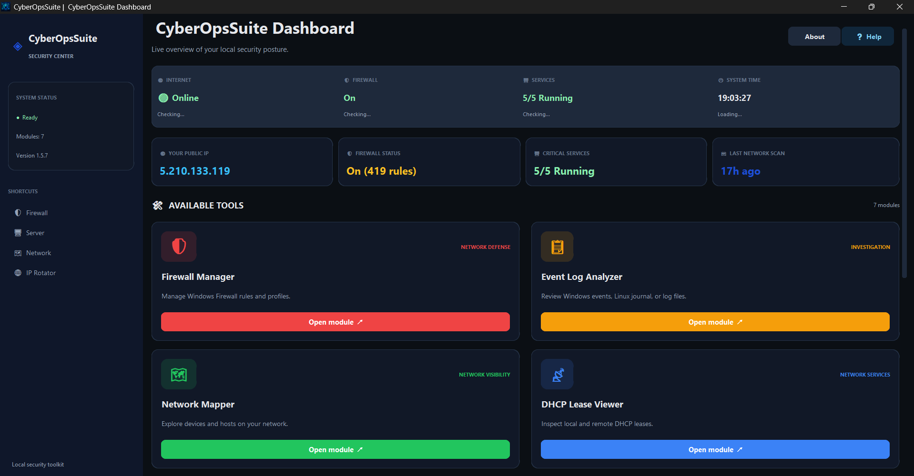
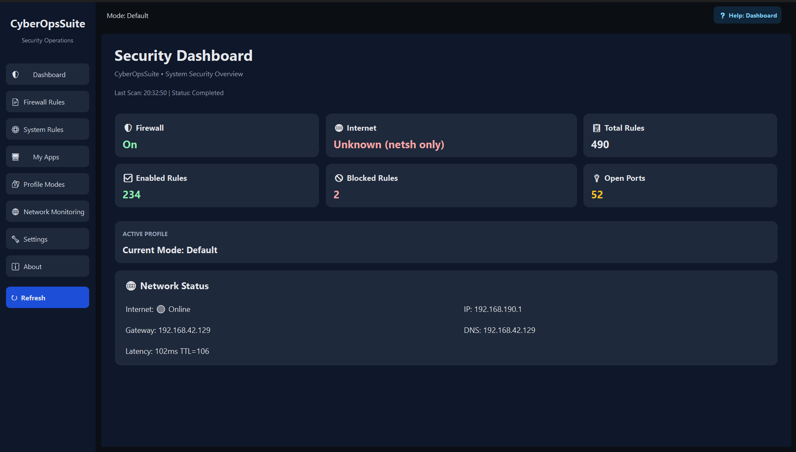
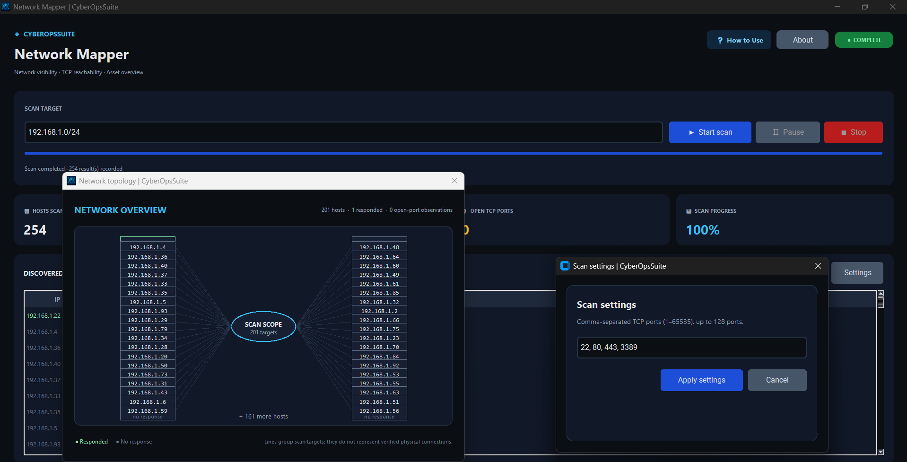
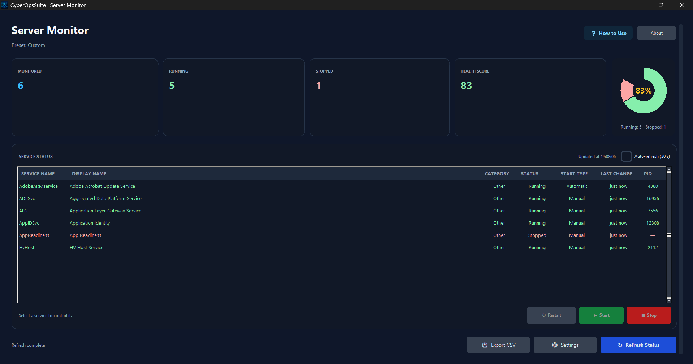
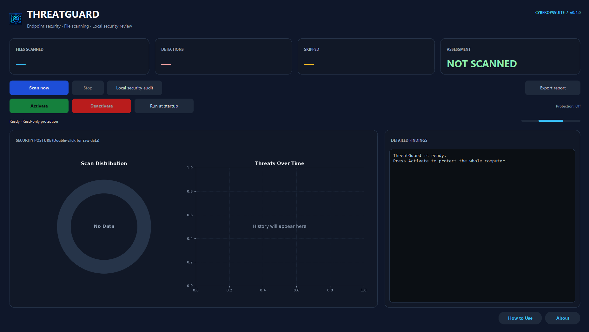
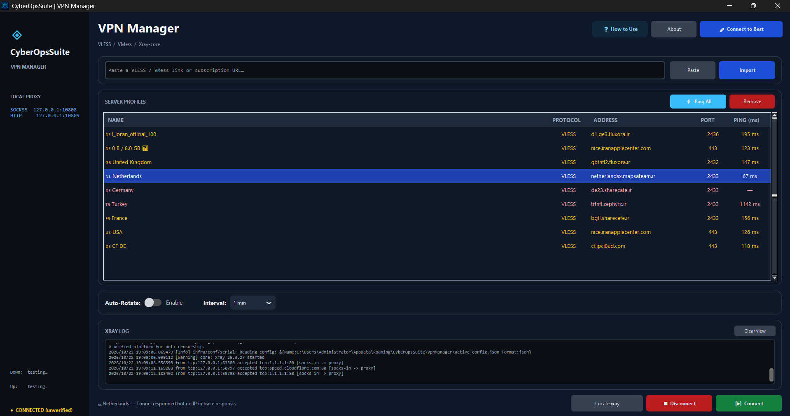
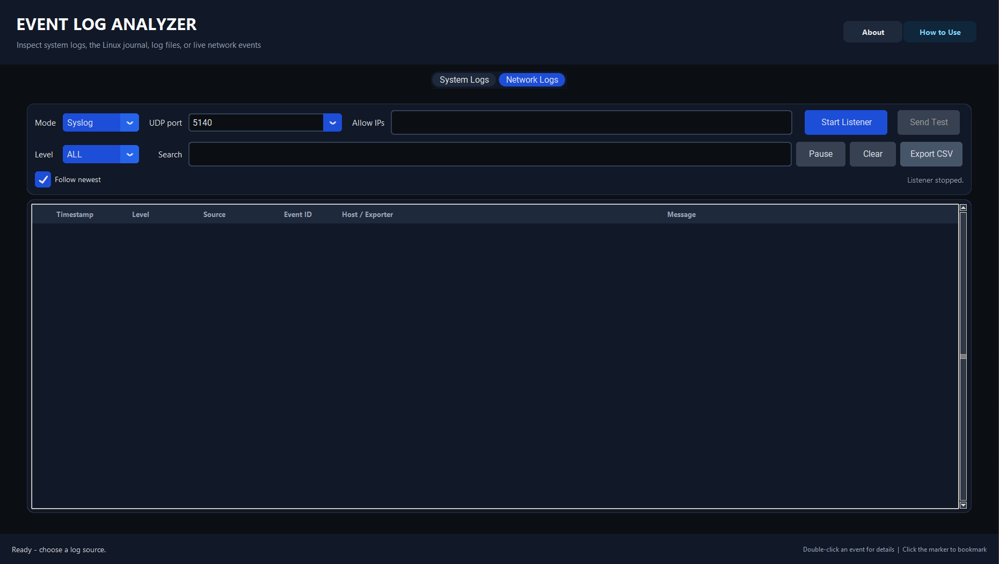
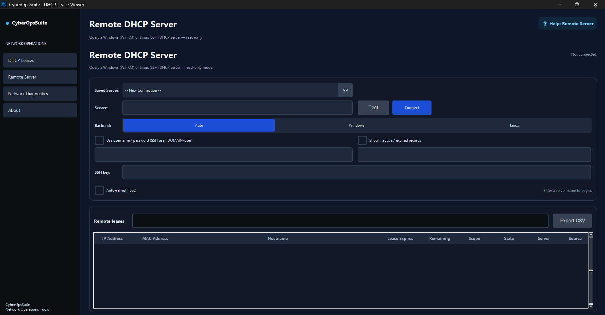
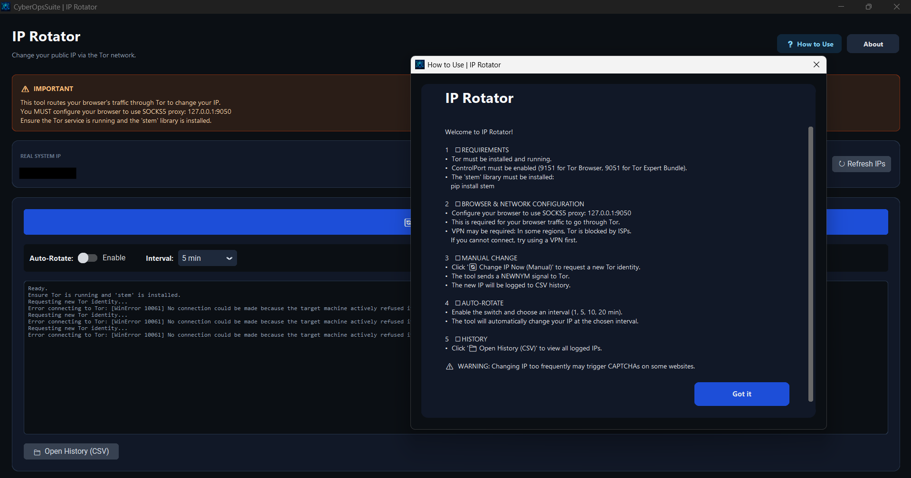

# CyberOpsSuite

**A modular, cross-platform security toolkit for Windows and Linux administrators.**

CyberOpsSuite bundles eight independent security tools under a single,
consistent dashboard. Every module runs in its own process, uses the same
dark theme, and can also be launched standalone. Every module ships with a
built-in **How to Use** guide (per-page where applicable).

> **📌 A note on how this project was built**
>
> CyberOpsSuite was built through **vibe coding** — a collaborative,
> iterative process between a human and an AI assistant. The code was
> written, reviewed, and refined through natural conversation rather
> than traditional step-by-step planning.
>
> We believe in being transparent about this. The project works, but
> it is the product of human-AI collaboration, not a solo human effort.
> Contributions, bug reports, and constructive feedback are welcome.

---

## 📥 Download

You can download the latest standalone Windows release here:
👉 **[Download CyberOpsSuite (Windows)](https://github.com/LorinBuilds/CyberOpsSuite/releases/latest)**
*(No Python installation is required to run the executable)*

---

## 📸 Screenshots

A quick overview of the modules available in CyberOpsSuite:

| Module | Preview |
| :--- | :--- |
| **Dashboard** |  |
| **Firewall Manager** |  |
| **Network Mapper** |  |
| **Server Monitor** |  |
| **ThreatGuard** |  |
| **VPN Manager** |  |
| **Event Log Analyzer** |  |
| **DHCP Lease Viewer** |  |
| **IP Rotator** |  |

---

## Modules

| Module | Purpose | Platform |
|--------|---------|----------|
| Firewall Manager | Manage firewall rules (netsh / ufw / nft / iptables) | Windows + Linux |
| Event Log Analyzer | Read Windows event logs, Linux journal, JSON Lines files, or live Syslog / NetFlow traffic | Windows + Linux |
| Network Mapper | Concurrent ICMP + TCP host discovery and port scanning | Windows + Linux |
| DHCP Lease Viewer | View local leases and query remote DHCP servers | Windows + Linux |
| Server Monitor | Monitor and control local services with health score and donut chart | Windows + Linux |
| **ThreatGuard** ⭐ | Read-only endpoint defense: file scanning, continuous guard, system review, audit, hardening, rootkit checks, integrity baselines | Windows + Linux |
| VPN Manager | Manage VLESS/VMess profiles with Xray-core, REALITY, Smart Auto-Switch, and live speed | Windows + Linux |
| IP Rotator | Change your public IP via the Tor network | Windows + Linux |

---

## Key Features

### Suite-wide
- **Unified dark dashboard** with live system status, global stats, and recent activity
- **Built-in How to Use guide** in every module (per-page for multi-page modules)
- **Thread-based operations** — the UI never freezes
- **Read-only by default** — no module modifies remote systems without explicit action
- **Cross-platform** — Windows 10/11/Server 2019+ and Linux (systemd-based)
- **Logging to AppData** — every module writes a log file for troubleshooting
- **Multiple export formats** — JSON, CSV, HTML
- **Desktop notifications** for critical events
- **Standalone GUI, CLI and (optional) local HTTP API** for most modules

### Event Log Analyzer
- **System Logs tab** — Windows Event Logs (Application/System/Security), Linux journal (System/User/Kernel), JSON Lines files
- **Network Logs tab** — live UDP capture of **Syslog** (RFC 3164 / RFC 5424) and **NetFlow v5**
- **Live counters** — packets, events, rate, rejected, malformed, unsupported, dropped
- **Bookmarks** — pin events for later review
- **Pause / Resume** — freeze the table while capture continues
- **Follow newest** — auto-scroll to the latest event
- **Send Test** — verify the listener with a sample packet
- **Auto refresh** — reload system logs every 5–60 seconds
- **CSV injection protection** — formula-like cells are neutralised
- **Suspicious flow classification** — bare SYN to sensitive ports (RDP/SSH/SMB…) flagged as ERROR

### ThreatGuard
- **File scanning** — SHA-256 hash reputation, built-in signatures, YARA (optional), ClamAV (optional)
- **Continuous Guard mode** — periodic background review of every drive with change-based caching
- **USB watcher** — removable drives scanned the moment they are plugged in
- **Full system review** — event logs, autostart entries, running processes, and network connections
- **Local security audit** — SSH key permissions, OS information, manual reminders
- **Rootkit indicators** — `ld.so.preload`, hidden paths, suspicious drivers, `svchost.exe` anomalies
- **Server hardening** — SSH config, world-writable files, Windows Firewall, SMBv1
- **Integrity baselines** — SHA-256 file trees, compared on demand
- **Suspicious log analysis** — auth failures, SQLi, XSS, path traversal, reverse shells, crypto miners
- **Read-only by design** — nothing is ever deleted, quarantined, or modified
- **GUI with charts** — pie chart of scan distribution, line chart of threats over time
- **System tray** — minimise to tray while protection runs
- **Auto-start with Windows** — optional per-user startup entry
- **Notifications** — tray balloons, PowerShell toasts, plyer
- **Local REST API + CLI** — scripting without the GUI

### VPN Manager
- **VLESS + REALITY + Post-Quantum encryption** — modern Xray protocols
- **VMess** support with optional flow
- **Networks** — TCP, WebSocket, gRPC, HTTPUpgrade, xhttp / splithttp
- **TLS + certificate pinning** — works with self-signed servers without `allowInsecure`
- **Subscription URL import** — one-click import of all servers
- **Iranian routing** — `geosite:category-ir` and `domain:ir` bypass the tunnel
- **Sniffing** — HTTP/TLS/QUIC routing by real destination hostname
- **Smart Auto-Switch** — periodic latency test, switches to the fastest server
- **Connect to Best** — auto-ping and connect to the fastest profile
- **Per-site test** — YouTube / Instagram / X / Telegram through every profile
- **Live speed test** — Cloudflare down/up in Mbps
- **System proxy** — Windows and GNOME, saved and restored automatically
- **Safe orphan cleanup** — only kills the Xray process it started
- **Local SOCKS5 (10808) + HTTP (10809)**

---

## Quick Start

### Dashboard (recommended)

    python -m dashboard.main

Then click **Open module** on any card.

### Single module

    python -m firewall_manager.gui.main
    python -m event_log_analyzer.gui.main
    python -m network_mapper.gui.main
    python -m dhcp_lease_viewer.gui.main
    python -m server_monitor.gui.main
    python -m threat_guard.gui.main
    python -m vpn_manager.gui.main
    python -m ip_rotator.gui.main

### Event Log Analyzer CLI

    python -m event_log_analyzer.cli.main app.log
    python -m event_log_analyzer.cli.main --windows System --max-events 500
    python -m event_log_analyzer.cli.main --linux Kernel --level ERROR
    python -m event_log_analyzer.cli.main --listen syslog --port 5140 --duration 60
    python -m event_log_analyzer.cli.main --listen netflow --allow 192.168.1.1
    python -m event_log_analyzer.cli.main app.log --format csv -o events.csv

### ThreatGuard CLI

    python -m threat_guard scan <target>
    python -m threat_guard full
    python -m threat_guard audit
    python -m threat_guard rootkit
    python -m threat_guard hardening
    python -m threat_guard baseline-create <target> <output.json>
    python -m threat_guard baseline-compare <target> <baseline.json>
    python -m threat_guard log-analyze <path>

### VPN Manager CLI

    python -m vpn_manager.cli.main list
    python -m vpn_manager.cli.main import "vless://..."
    python -m vpn_manager.cli.main connect <id>
    python -m vpn_manager.cli.main test
    python -m vpn_manager.cli.main status
    python -m vpn_manager.cli.main disconnect

### Local HTTP APIs (optional)

    uvicorn event_log_analyzer.api.main:app --host 127.0.0.1 --port 8000
    uvicorn threat_guard.api.main:app      --host 127.0.0.1 --port 8001
    python -m vpn_manager.api.main          # 127.0.0.1:8010

---

## Requirements

* **Python 3.10+** (tested on 3.14)
* **pip**

### Install dependencies

    pip install -r requirements.txt

### Optional packages

| Package | Used by | Purpose |
|---------|---------|---------|
| `plyer` | Server Monitor, ThreatGuard | Desktop notifications |
| `paramiko` | DHCP Lease Viewer | Password-based SSH (Linux remote backend) |
| `stem` | IP Rotator | Tor controller integration |
| `psutil` | ThreatGuard, VPN Manager | Process/network review and drive listing |
| `pystray` | ThreatGuard | System tray icon |
| `matplotlib` | ThreatGuard | Scan distribution and trend charts |
| `yara-python` | ThreatGuard | YARA rule matching |
| `clamd` / ClamAV | ThreatGuard | Malware signature scanning |
| `uvicorn` + `fastapi` | HTTP APIs | Optional local REST APIs |

### Per-module requirements

| Module | Windows | Linux |
|--------|---------|-------|
| Firewall Manager | Administrator | sudo + ufw/nft/iptables |
| Event Log Analyzer | PowerShell + admin for Security log | journalctl + systemd-journal group |
| Network Mapper | — | — |
| DHCP Lease Viewer | PowerShell + WinRM (RSAT-DHCP for remote) | systemd-networkd + SSH |
| Server Monitor | Administrator | sudo |
| ThreatGuard | Administrator for full review (event logs, SMB, firewall) | sudo for full review |
| VPN Manager | `bin/xray.exe` | `bin/xray` |
| IP Rotator | Tor + ControlPort | Tor + ControlPort |

> **ThreatGuard extra deps**: install `threat_guard/requirements.txt`
> for YARA and ClamAV support (optional — scanning works without them).
> **ClamAV** must be installed and `clamscan` on `PATH` for the batch scan.

---

## Project Structure

    CyberOpsSuite/
    |-- dashboard/              Launcher for all modules
    |-- core/                   Shared code
    |   |-- theme.py
    |   |-- gui/treeview_style.py
    |   |-- utils/
    |       |-- icons.py
    |       |-- paths.py
    |       |-- subprocess_utils.py
    |-- firewall_manager/
    |-- event_log_analyzer/     GUI + CLI + API + Syslog/NetFlow listeners
    |   |-- gui/
    |   |-- cli/
    |   |-- api/
    |   |-- core/               parser, filters, levels, exporters,
    |   |                       bookmarks, windows_events, linux_events,
    |   |                       listeners, syslog_events, netflow_events
    |-- network_mapper/
    |-- dhcp_lease_viewer/
    |-- server_monitor/
    |-- threat_guard/           Scans, guard, audit, hardening, API, CLI
    |   |-- engine/             scanner, audit, hardening, integrity,
    |   |                       log_analyzer, rootkit, guard, protection,
    |   |                       system_review, signature, reports
    |   |-- gui/                main, theme
    |   |-- api/                FastAPI (local-only)
    |   |-- cli/                argparse commands
    |   |-- utils/              notifications, startup
    |   |-- data/               Example YARA rules + hash reputation
    |   |-- requirements.txt
    |-- vpn_manager/            Xray-core wrapper with GUI + CLI + API
    |   |-- core/               xray_manager
    |   |-- gui/
    |   |-- cli/
    |   |-- api/
    |-- ip_rotator/
    |-- assets/icons/
    |-- bin/                    Xray-core + wintun + geoip/geosite
    |-- data/                   Sample data
    |-- exports/                Runtime exports
    |-- requirements.txt
    |-- README.md
    |-- README.FA.md

---

## Configuration

Per-user configuration:

| Platform | Location |
|----------|----------|
| **Windows** | `%APPDATA%\CyberOpsSuite\<Module>\` |
| **Linux**   | `~/.config/CyberOpsSuite/<Module>/` |

The `data/` directory contains sample files for reference only.
Your profiles, logs and settings are stored in the per-user directory above.

---

## Building an Executable

    pip install pyinstaller
    python build.py

The build script creates:

* `dist/CyberOpsSuite/CyberOpsSuite.exe` — dashboard launcher
* `dist/CyberOpsSuite/modules/<Name>/<Name>.exe` — one EXE per module (including `ThreatGuard.exe` and `VPNManager.exe`)
* `dist/installer/CyberOpsSuite_Setup_<ver>.exe` — Windows installer (Inno Setup 6+)

You can also build a single target:

    python build.py dashboard
    python build.py modules
    python build.py --clean
    python build.py --installer-only

---

## Platform Support

* ✅ Windows 10 / 11 / Server 2019+
* ✅ Linux (systemd-based distributions)
* ❌ macOS — not supported
  (ThreatGuard and VPN Manager rely on Windows/Linux-specific backends)

---

## Responsible Use

Use CyberOpsSuite only on systems you own or have explicit permission
to assess. Scanning, firewall modification, log analysis, network
capture, and VPN configuration can have legal and operational
consequences on networks you do not administer.

---

## Extending the Suite

1. Create a package with `core/`, `gui/main.py`, `api/main.py`, `cli/main.py`
2. Import shared helpers from `core.theme`, `core.utils.icons`, `core.utils.paths`
3. Add an entry to the `TOOLS` list in `dashboard/main.py`
4. Add the module's EXE name to `MODULE_TO_EXE` in `dashboard/main.py` (EXE mode)
5. Add the module to `MODULES` and `PROJECT_PACKAGES` in `build.py`
6. Add a `How to Use` guide following the pattern in other modules

---

## Keyboard Shortcuts

| Shortcut | Action |
|----------|--------|
| F5 / Ctrl+R | Refresh current page |
| F1 | Open About |
| Enter | Connect / Open details |
| Delete | Remove selected item |
| Escape | Close dialogs / clear filters |
| Ctrl+O | Open file (Event Log Analyzer) |
| Ctrl+F | Focus search |
| Ctrl+L | Clear filters |
| Ctrl+E | Export CSV |

---

## License

Provided as-is for educational and authorized administrative use.
Third-party binaries (xray, wintun) are covered by their own
licenses — see `bin/LICENSE` and `bin/LICENSE-wintun.txt`.

---

## Acknowledgements

* [CustomTkinter](https://github.com/TomSchimansky/CustomTkinter) — modern dark UI
* [Xray-core](https://github.com/XTLS/Xray-core) — VPN engine
* [Wintun](https://www.wintun.net/) — Windows TUN driver
* [FastAPI](https://fastapi.tiangolo.com/) — optional HTTP APIs
* [Plyer](https://github.com/kivy/plyer) — desktop notifications
* [Paramiko](https://www.paramiko.org/) — password-based SSH
* [Stem](https://stem.torproject.org/) — Tor controller
* [Pystray](https://github.com/moses-palmer/pystray) — system tray icon
* [Matplotlib](https://matplotlib.org/) — ThreatGuard charts
* [YARA](https://virustotal.github.io/yara/) — pattern-matching rules (optional)
* [ClamAV](https://www.clamav.net/) — antivirus engine (optional)